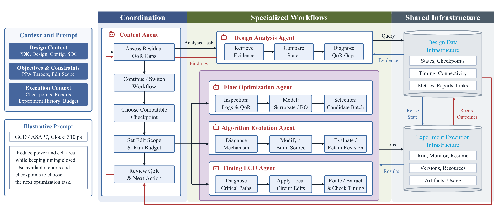
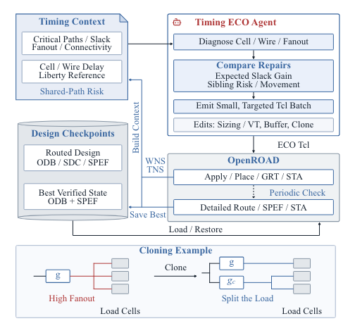
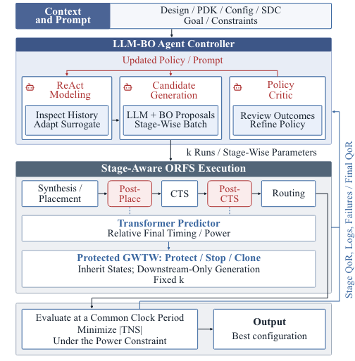
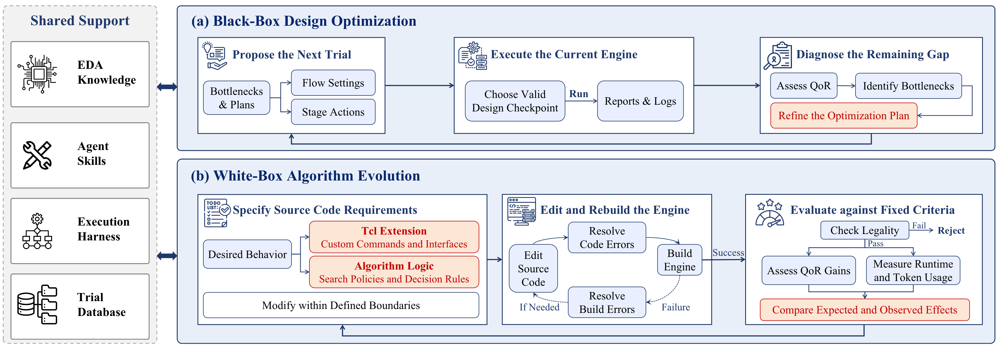

# EDA Paper Figure Skill

面向 EDA 论文的科研配图 skill，支持架构图、流程图、原理图、罗列图、讲解图和对比图。
从论文内容出发，组织对象、层级与关系，统一字体和系列风格，交付论文 PDF 与可编辑 PPT / Draw.io。

## 成果展示

### 多 Agent 系统架构



<table>
  <tr>
    <th width="50%">Timing ECO：系统交互与局部原理</th>
    <th width="50%">A2-ORFO：单栏方法流程</th>
  </tr>
  <tr>
    <td align="center"></td>
    <td align="center"></td>
  </tr>
</table>

### 黑盒设计优化与白盒算法演化



## 大模型作图常见的问题

- **没有视觉重心**：所有模块等大、等亮、等强调，读者找不到关键机制。
- **结构混乱**：角色、阶段、动作、数据和示例混在同一层，包含关系与协作关系难以分辨。
- **文字堆砌**：大量罗列“分析、优化、评估”，具体决策和运行过程交代不足。
- **箭头随意**：指向不准、折点过多、分叉拥挤，请求与反馈混成双向线。
- **层次模糊**：浅色叠加、对比不足，背景板、内容框和文字糊在一起。
- **排版失控**：字体、字号、大小写、行距和内边距各用一套；同一段文字被拆成多个独立文本框。
- **图标喧宾夺主**：卡通化、重复、尺寸过大，装饰占去了机制解释的空间。
- **空间分配失衡**：简单部分占满大框，复杂部分挤在角落，空白与拥挤同时存在。
- **模板重复**：不同方法采用相同的卡片和层板布局，换一套文字就成为另一张图。
- **补充说明泛滥**：浅色小字、长脚注和防御性解释不断增加，冲淡主体信息。

## Skill 的 10 个特点

1. **按图的任务选择构图**

   区分架构、流程、原理、罗列、讲解和对比；混合图按区域采用合适的表达方式。

2. **依据论文与代码组织内容**

   核对对象、动作、条件和验证依据，让读者理解方法如何工作。

3. **用视觉语法表达对象与主次**

   通过范围、位置、形状和面积区分 Agent、工具、数据、步骤与示例，把空间留给核心机制。

4. **为箭头定义语义和几何**

   明确源、目标、载荷和方向，检查锚点、分叉、汇合、回路与箭杆空间。

5. **建立清楚的背景与内容层次**

   用克制的色系、可辨的边界和白色内容区组织信息，长说明有归属，关系标签就近标注。

6. **统一字体、字号和命名**

   默认 Times New Roman，统一同级文字样式、大小写、专业缩写、公式和符号。

7. **以语义段落管理文字**

   同框连续内容使用一个多行文本对象，统一控制字距、行距、段距、对齐和内边距。

8. **从 Flaticon 选取可编辑图标**

   按对象含义选择适量、同风格的图标，将矢量素材转换成 PPT 原生形状或路径，保留部件编辑能力。

9. **兼顾单栏紧凑与系列统一**

   按最终出版尺寸分配空间，保留关键机制和阅读间隙；系列共用视觉语言，各图拥有适合内容的布局。

10. **交付原生文件并核验结果**

    按需提供矢量 PDF、PPTX 或 Draw.io，检查内容、字体、文字边界、真实连线路径和最终渲染。

## 使用

将仓库安装到 Codex 的 skills 目录：

```bash
git clone https://github.com/yuan-fd/EDA-Paper-Figure-Skill.git ~/.codex/skills/eda-paper-figure
```

提供论文相关段落、原图或可编辑文件，并说明目标版面与交付格式。例如：

```text
使用 $eda-paper-figure，依据论文重排这张方法图。
按 ACM 单栏组织内容，统一 Times New Roman 和系列色调。
从 Flaticon 选择合适图标，交付矢量 PDF 和图标可编辑的 PPT。
```

完整规则见 [SKILL.md](SKILL.md)，图标选取与转换见 [图标来源与 PPT 可编辑交付](references/icons-and-editability.md)。
